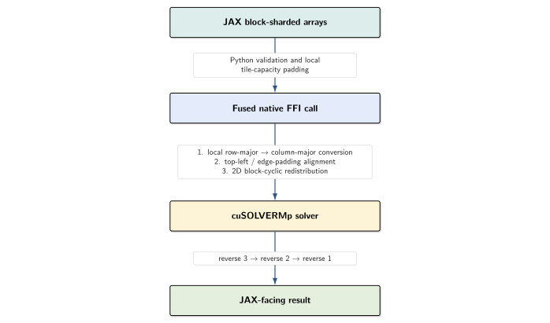
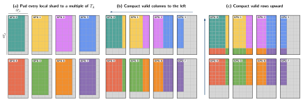
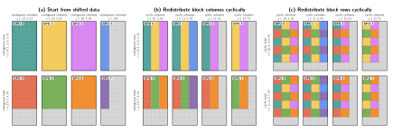

# Native workflow

JAXMg accepts ordinary JAX arrays sharded over a one- or two-axis device mesh.
However, cuSOLVERMp requires column-major local buffers distributed in a 2D
block-cyclic layout. The native backend bridges these layouts inside one fused
C++/CUDA FFI call:

<figure markdown="span" class="memory-distribution-figure">
  [{ .memory-distribution-image }](../_static/flowcharts/jaxmg_general.svg)
</figure>

Python calculates static metadata such as the process grid, the process-grid
slot of every mesh partition, logical matrix size, tile size, and padded local
capacity. It needs only the abstract JAX mesh: the native backend places the
communicator ranks on the process grid from XLA's device assignment at run
time. C++/CUDA owns the data
movement, cuSOLVERMp descriptors and workspace, solver calls, and reverse
redistribution. Matrix data remains GPU-resident throughout this workflow, and
the in-place transformations reuse bounded native scratch storage to minimize
memory overhead.

Matrix-valued solver outputs follow the reverse path shown above. The
eigenvalues-only SYEVD mode returns the replicated eigenvalue array directly
after solver execution.

## Scratch allocation

The redistribution path uses one native scratch allocation per FFI call. Its
size is determined by the largest tile slab used by the 2D block-cyclic stage:

$$
N_{\mathrm{scratch}}
=
3\max\left(
  T_c N_{\mathrm{local\ rows}},
  T_r N_{\mathrm{local\ cols}}
\right).
$$

For square solver tiles, $T_r=T_c=T_A$. The layout-conversion and edge-padding
stages reuse this allocation and process data in bounded batches. They do not
allocate a second full local matrix.

## Memory-distribution stages
The memory redistribution is performed in three stages.

### Stage 1: local memory layout conversion
  JAX presents each local matrix shard in row-major physical memory.
  cuSOLVERMp expects column-major local memory. CUDA kernels apply an in-place
  rectangular permutation using bounded scratch; the logical matrix is not
  transposed. This stage is local to each GPU and requires no communicator
  traffic.

  [Layout-conversion details](memory_distribution.md#stage-1-local-layout-conversion)

### Stage 2: top-left and edge-padding alignment

  Python provides tile-aligned local capacity. Native horizontal compaction
  moves real column slabs toward the global left edge, then vertical
  compaction moves real row slabs toward the global top edge. Padding is
  consolidated on the global right and bottom edges.

  Moves in one horizontal wave are independent across process rows. Moves in
  one vertical wave are independent across process columns.

  [{ .memory-distribution-image }](../_static/memory_distribution/block_cyclic_padding_alignment.svg)

  [Edge-padding details](memory_distribution.md#stage-2-top-left-edge-padding-alignment)

### Stage 3: 2D block-cyclic redistribution

  Whole tile slabs are redistributed in two separable phases. The
  column-owner phase assigns each tile to the correct process column; the
  row-owner phase then assigns each tile to the correct process row.

  Same-rank moves use local CUDA operations. Cross-rank moves use the
  NCCL-backed communicator borrowed from XLA. The same communicator supplies
  the `ncclComm_t` used by cuSOLVERMp.

  [{ .memory-distribution-image }](../_static/memory_distribution/block_cyclic_redistribution.svg)

  [2D block-cyclic details](memory_distribution.md#stage-3-2d-block-cyclic-redistribution)

## Solver workflows

The routines share the forward redistribution stages and then execute the
following cuSOLVERMp calls:

- `potrs` calls `cusolverMpPotrf` followed by `cusolverMpPotrs`, optionally
  extracting `log(det(A))` from the same factorization.
- `potrf` calls `cusolverMpPotrf` to return the lower Cholesky factor.
- `lu_solve` calls `cusolverMpGetrf` followed by `cusolverMpGetrs`.
- `getrf` calls `cusolverMpGetrf` to return the packed LU factor and pivots.
- `potri` calls `cusolverMpPotrf` followed by `cusolverMpPotri`.
- `getri` calls `cusolverMpGetrf` followed by `cusolverMpGetri`.
- `least_squares` calls `cusolverMpGels` for tall or square systems.
- `qr` calls `cusolverMpGeqrf` followed by `cusolverMpOrgqr` to form reduced Q.
- `syevd` calls `cusolverMpSyevd` for eigenvalues and optional eigenvectors.
- `gesvd` calls `cusolverMpGesvd`, with U and Vh selected independently.
- `polar` calls `cusolverMpPolar` for the polar factor and optional H.

Buffer reuse and output restoration are described in
[Solver-specific native work](memory_distribution.md#solver-specific-native-work).

## Solver setup

Each Python process owns one GPU and contributes one rank to the XLA/NCCL and
cuSOLVERMp communicators. See [Distributed execution](../examples/execution.md)
for the required launch model.

To avoid repeated initialization, routines share one cached cuSOLVERMp handle
per GPU and grids keyed by XLA communicator group, process-grid shape, and
mapping. Calls sharing a handle are serialized until their CUDA work completes;
matrix descriptors and explicit solver workspaces remain local to each call.

Cached grids follow the lifetime of their XLA communicator group. Healthy
groups release their grids before the NCCL communicator, and the last group
on a device releases the handle.
Set `JAXMG_CUSOLVERMP_CACHE=0` before starting every process
to disable reuse for timing comparisons or debugging.

## Failure handling

Numerical failures return NaN results and a nonzero solver status. Fatal handle
or grid setup failures, and grid-destruction failures, instead terminate the
affected process to avoid further unsafe collective operations. Peer shutdown
depends on JAX's failure detection and the launcher.

An unhealthy communicator cannot safely participate in grid destruction, so
its cached native resources are retained until process exit and further cache
use is rejected. Restart the distributed job after a fatal failure.

## Detailed implementation

[Memory distribution](memory_distribution.md) gives the complete diagrams,
layout definitions, dependency waves, permutation cycles, reverse path, and
source-code map.
